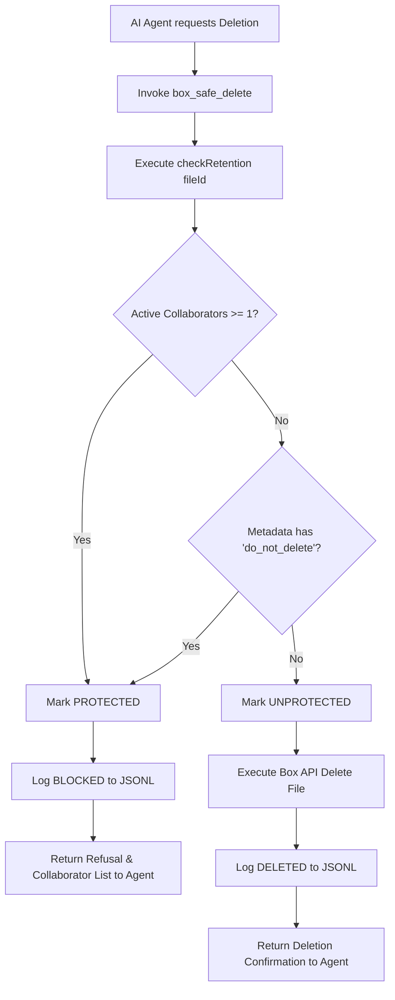

# Box Productivity Suite — Enterprise Retention & Deletion-Protection Policy

## 1. Executive Summary & Policy Objective

In modern enterprise workflows, files and documents stored in cloud repositories like Box are frequently subject to accidental deletion, orphaned file loss when employees transition or depart, and unintentional data destruction by automated scripts or AI assistants.

The **Box Productivity Suite Retention Guard** establishes an automated, deterministic policy engine that prevents the deletion of critical enterprise assets.

---

## 2. Core Business Protection Rules

A Box file is classified as **PROTECTED** and **CANNOT BE DELETED** under any standard automated or AI action if **either** of the following conditions is met:

### Condition A: Active Collaborators Protection Rule
$$\text{Protection Status} = \text{TRUE} \iff \text{Count}(\text{Active Collaborators}) \ge 1$$

- **Definition of Active Collaborator**: Any collaborator attached to the file with an `accepted` status or pending valid invitation, possessing any of the following roles:
  - `Editor`
  - `Viewer`
  - `Previewer`
  - `Uploader`
  - `Previewer Uploader`
  - `Viewer Uploader`
  - `Co-Owner`
- **Rationale**: If a file is shared with active team members, it remains an active asset in enterprise operations regardless of whether the original file owner has left the company or requested cleanup.

### Condition B: Explicit Metadata Tagging Rule
$$\text{Protection Status} = \text{TRUE} \iff \text{"do\_not\_delete"} \in \text{File Metadata/Tags}$$

- **Definition of Retention Tag**:
  - Box file tag containing `do_not_delete` or `retention_protected`
  - Box custom metadata template attribute with key/value `do_not_delete = true`
  - Box file description containing `[do_not_delete]` or `[protected]`
- **Rationale**: Enables compliance officers, project leads, legal hold administrators, and AI governance engines to freeze documents from modification or purging.

---

## 3. Strict Deletion Protocol (`box_safe_delete`)

To eliminate unauthorized purges, the suite strictly enforces:

1. **NO RAW DELETE TOOL EXPOSURE**: The MCP Server explicitly does **not** provide any unconstrained delete tool (`box_delete_file` or raw API purge).
2. **Mandatory Retention Check**: Any deletion request invoked via `box_safe_delete` triggers an immediate evaluation of `checkRetention(fileId)` before any destructive API call is dispatched.
3. **Deterministic Refusal**:
   - If `protected == true`, deletion is immediately halted, returning a refusal response explaining which collaborators or tags triggered protection.
   - If `protected == false`, the file is safely deleted via Box API.
4. **Comprehensive Immutable Audit Logging**: Every retention check, deletion refusal, policy change, and permitted deletion is appended to `data/retention-log.jsonl`.

---

## 4. Audit Log Schema & Retention Trail

Audit records are logged in JSONL format to `data/retention-log.jsonl`:

```json
{
  "timestamp": "2026-10-29T15:35:00.000Z",
  "fileId": "139820491823",
  "decision": "BLOCKED",
  "reason": "DELETION BLOCKED: File has 2 active collaborator(s): John Doe (jdoe@ibm.com, editor); Alice Smith (asmith@ibm.com, viewer)",
  "details": {
    "fileName": "2026_Q3_Strategic_Financial_Forecast.pdf",
    "activeCollaborators": [
      {
        "id": "11982736",
        "name": "John Doe",
        "email": "jdoe@ibm.com",
        "role": "editor",
        "status": "accepted"
      }
    ],
    "metadataFlags": ["do_not_delete"]
  }
}
```

### Log Decision Categories
- `CHECKED`: Informational evaluation requested by an agent or user.
- `BLOCKED`: Deletion attempt prevented due to active collaborators or retention flags.
- `DELETED`: Permanent deletion executed following zero-protection verification.
- `POLICY_SET`: Retention protection tag or metadata applied to the target asset.

---

## 5. Agent Workflow Diagram


